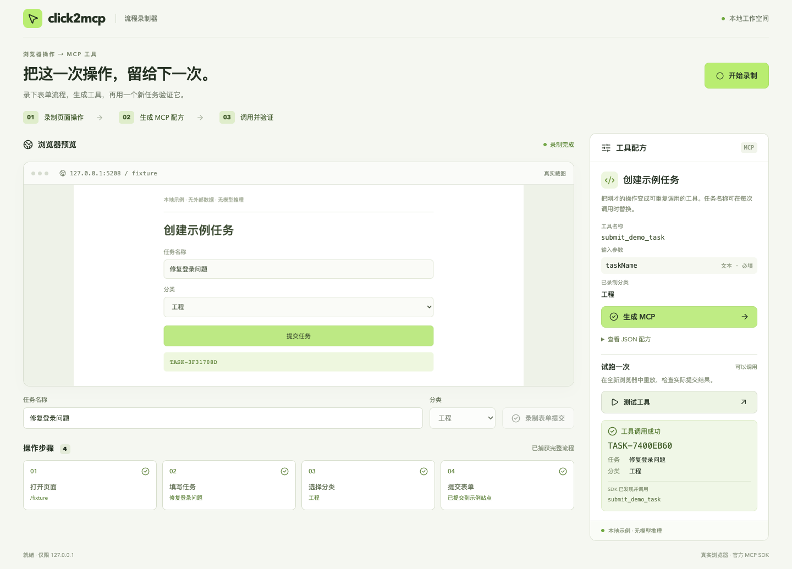
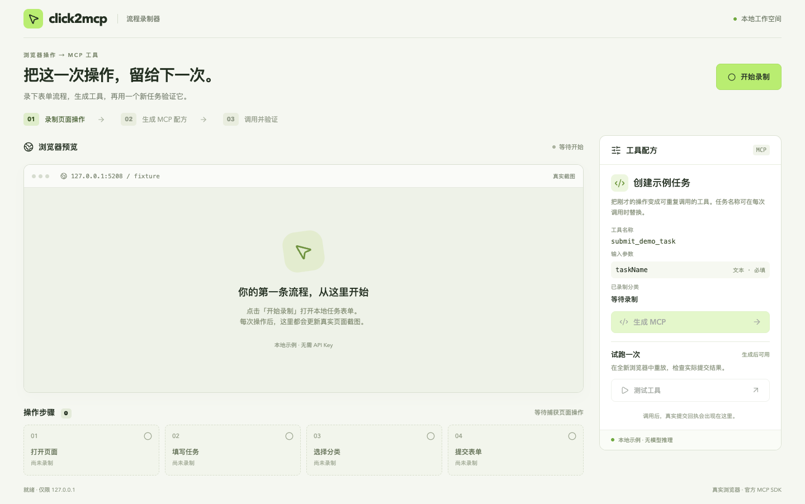

# Click2MCP

**浏览器里做过一遍的表单操作，能不能变成一个工具？**

Click2MCP 用“创建任务”这个小流程给你看答案：录下填写和提交，生成一份操作配方，再通过官方 MCP SDK 调用。右侧出现任务回执时，你看到的是一次新的浏览器执行结果。



### 从点页面，到调用工具

如果你正在学 MCP，或想设计浏览器自动化工具，这里把几个容易混在一起的环节拆开了：

| 环节 | 实际发生的事 |
| --- | --- |
| 录制 | Chromium 打开示例页面，捕获填写、选择和提交 |
| 生成 | 将四步动作变成受限 JSON 配方与 `submit_demo_task` 工具 |
| 调用 | SDK 发现工具，在全新浏览器上下文执行，读取任务回执 |

**当前只支持内置任务表单。** 不需要 AI 或 API Key，也不能录制任意网站；配方由确定性逻辑生成。

### 在本机打开

准备 **Node.js 24 LTS** 与 npm（也支持 22.12+ 的 22 系列及 26+；不支持 23/25），然后运行：

```sh
git clone https://github.com/shenyangs/click2mcp.git
cd click2mcp
npm run setup
npm run doctor
npm run dev
```

浏览器打开 [http://127.0.0.1:4208](http://127.0.0.1:4208)，终端保持运行；结束时按 Ctrl+C。首次 setup 会联网安装依赖与测试浏览器，下载时间取决于网络。安装问题见 [使用手册](docs/usage.md)。

### 做出你的第一个任务工具

1. 点击 **开始录制**，填写“修复登录问题”，选择“工程”，点击 **录制表单提交**。
2. 时间线出现四步后，点击 **生成 MCP**，查看 `submit_demo_task` 和可展开的 JSON 配方。
3. 点击 **测试工具**，等右侧出现 `TASK-…` 回执。修改任务名称再调用，看看同一配方怎样处理不同输入。



分类沿用录制时的选择，要更换分类需重新录制。中间是真实浏览器截图，每次操作后更新；通过截图下方的表单控制操作，不是可直接点击的远程浏览器。

### 这个原型走到了哪一步

录制、生成和真实 SDK 调用已经串起来，适合本地学习与演示。目前只有一个工具、一个内存会话，没有浏览器扩展、外部 MCP 托管或配方导入导出。重启后回执清空。

工具只接受指定来源、路径、字段和四步动作，不执行任意脚本。此前出现过一次回执等待超时，相同断言重跑通过，偶发原因仍未定位。

### 想继续看代码或验证结果

本地构建、单元测试、浏览器流程和演示录屏已经在 macOS 通过；README 配图来自实际运行的应用。Windows / Linux 实机与全新机器完整安装尚未验证。所有服务仅监听本机，没有部署所需的账号与鉴权，请勿直接暴露到公网。

停止开发服务后，可自行运行：

```sh
npm run build
npm run test
npm run e2e
npm run demo
```

[安装、排错与实现细节](docs/usage.md) · [验证记录与当前状态](status.json) · [MIT 许可](LICENSE)
